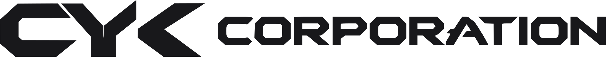

  <picture>
    <source media="(prefers-color-scheme: dark)" srcset="assets/cyk-corporation-dark.svg">
    
  </picture>

  Desenvolvemos aplicações, serviços e infraestrutura própria 
  de forma organizada, colaborativa e sustentável.

  
  

---

## Quem somos

Somos uma equipe que cria e mantém aplicações, serviços e a infraestrutura que os sustenta. Buscamos facilitar o desenvolvimento, compartilhar conhecimento e melhorar continuamente nossos projetos.

## O que fazemos

- 🖥️ **Aplicações** — produtos web e desktop.
- ⚙️ **Serviços** — APIs e integrações que conectam nossos produtos.
- 🛠️ **Infraestrutura** — servidores, automações e serviços que mantêm tudo no ar.

## Como trabalhamos

- Toda alteração passa por revisão em pull request.
- A documentação fica junto do projeto responsável por ela.
- Decisões importantes são registradas para consultas futuras.

## Para clientes

Quer tirar uma ideia do papel ou precisa de apoio com um projeto?
Fale com a gente: vamos entender a sua necessidade e propor o melhor caminho.

- 🌐 Site: [cykcorporation.com](https://cykcorporation.com)
- ✉️ E-mail: [contato@cykcorporation.com](mailto:contato@cykcorporation.com)

---

Obrigado pela visita!
